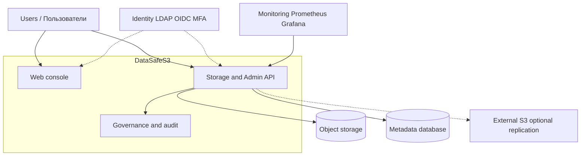

# DataSafeS3 · Датасейф S3

**По-русски:** [README.ru.md](README.ru.md) · [документация](docs/README.md) · [руководство пользователя](docs/ru/user-guide.md)

**Author / Автор:** Ilya Trachuk · **License / Лицензия:** [Apache-2.0](LICENSE) · **Release / Релиз:** [v1.7.2](CHANGELOG.md#171---2026-10-24)

The primary repository and the artifact registries (images, packages, Helm) are on [GitVerse](https://gitverse.ru/DirektorBani/DataSafeS3). GitHub is a [mirror](https://gitverse.ru/DirektorBani/DataSafeS3).

Локальное S3-совместимое объектное хранилище: один процесс или контейнер, метаданные Bolt, отдельная СУБД не нужна. Лицензия Apache-2.0. Интерфейс консоли доступен на русском и английском.

Установка, пакеты, Helm и основные документы продукта — в [README.ru.md](README.ru.md). Ниже та же справка на английском.

---

Self-hosted S3-compatible object storage you can run today: one binary or container, Bolt metadata, no extra database. Apache-2.0. A MinIO alternative for Docker, Compose, and Kubernetes.

## What you get

- S3 API on port 9000: put, get, head, list v2, multipart, copy, presigned URLs, versioning, and DeleteObjects (`aws s3 rm --recursive`, `mc`, rclone, restic)
- Web console, bucket policy, object lock, audit, optional SSE-S3 / SSE-KMS
- One node with Bolt, or several nodes that share Postgres metadata and copy object bytes to peers
- Prometheus `/metrics` with a bearer token. The public console proxy does not forward `/metrics`
- Release images on GitVerse (`gitverse.ru/direktorbani/...`) for `linux/amd64` and `linux/arm64`; SBOM (CycloneDX) files are attached to each GitVerse release. Images are not cosign-signed: verify by digest (see [SECURITY.md](SECURITY.md))

## Start

S3 API only:

```bash
docker run --rm -p 9000:9000 \
  -e STORAGE_ACCESS_KEY=datasafe \
  -e STORAGE_SECRET_KEY=change-me \
  -e STORAGE_ADMIN_PASSWORD=change-me-admin \
  -e STORAGE_JWT_SECRET=change-me-jwt \
  gitverse.ru/direktorbani/datasafe-storage-server:v1.7.2
```

Console and API, persistent volume, `STORAGE_DEV` off:

```bash
cp deploy/compose/production/.env.example deploy/compose/production/.env
docker compose --env-file deploy/compose/production/.env \
  -f deploy/compose/production/docker-compose.yml up -d
```

Kubernetes (set real secrets; the chart will not install with empty ones):

```bash
helm repo add datasafes3 https://gitverse.ru/api/packages/DirektorBani/helm
helm repo update
helm install ds datasafes3/datasafes3 --version 1.7.1 \
  --set storageServer.image.repository=gitverse.ru/direktorbani/datasafe-storage-server \
  --set console.image.repository=gitverse.ru/direktorbani/datasafe-console \
  --set auth.accessKey=datasafe \
  --set auth.secretKey=change-me \
  --set auth.adminPassword=change-me-admin \
  --set auth.jwtSecret=change-me-jwt \
  --set auth.metricsToken=change-me-metrics
```

Linux packages from the GitVerse apt and dnf repositories (the service is not started for you):

```bash
# Debian, Ubuntu
sudo mkdir -p /etc/apt/keyrings
sudo curl -fsSL https://gitverse.ru/api/packages/DirektorBani/debian/repository.key \
  -o /etc/apt/keyrings/gitverse-DirektorBani.asc
echo "deb [signed-by=/etc/apt/keyrings/gitverse-DirektorBani.asc] https://gitverse.ru/api/packages/DirektorBani/debian stable main" \
  | sudo tee /etc/apt/sources.list.d/gitverse-DirektorBani.list
sudo apt update && sudo apt install datasafes3

# Fedora, RHEL, Rocky, Alma (the RPM is not GPG-signed, hence --nogpgcheck)
sudo dnf install -y dnf-plugins-core
sudo dnf config-manager --add-repo https://gitverse.ru/api/packages/DirektorBani/rpm/stable.repo
sudo dnf install datasafes3 --nogpgcheck

sudoedit /etc/datasafes3/datasafes3.env
sudo systemctl enable --now datasafes3
```

Guides: [Kubernetes](docs/kubernetes.md) · [Linux packages](docs/linux-packages.md) · [GitVerse registries (RU)](docs/ru/gitverse-mirror.md) · [Move from MinIO](docs/migrate-from-minio.md) · [Production checklist](docs/production-checklist.md) · [S3 compatibility](docs/compatibility.md)

The image tag above is the release pin. The registry is public; `latest` points to the same release. Images, packages, and the Helm chart are listed on the [GitVerse packages page](https://gitverse.ru/DirektorBani/DataSafeS3/packages).

---

## Self-hosted storage platform for secure and governed data management

**Платформа локального хранения для безопасного управления данными и политиками доступа**

---

Organizations accumulate files, backups, media, and application data that must stay under their own control. DataSafeS3 gives teams a single platform to **store data securely**, **integrate corporate identity**, **govern lifecycle and quotas**, and **observe operations** — without depending on a public cloud vendor for administration or policy.

DataSafeS3 is built for **IT administrators**, **platform engineers**, **security teams**, and **business units** that need governed object storage on their infrastructure: on a single server, in Docker Compose, or in Kubernetes with Helm.

The product combines **S3-compatible storage**, a **web console**, **enterprise authentication**, and **operational tooling** in one self-hosted solution.

| | |
|---|---|
| **Secure storage** | Centralized access control, encryption options, object lifecycle |
| **Identity integration** | LDAP, OIDC/SSO, MFA for privileged accounts |
| **Governance** | Tenants, quotas, retention, replication policies |
| **Auditability** | Activity log and external log sinks |
| **Collaboration** | Personal web workspace, bucket/folder sharing, presigned links; desktop sync (`datasafe-sync` CLI + optional Tauri UI) |
| **Observability** | Prometheus metrics and Grafana dashboards |
| **Production trust** | Release images on GitVerse with CycloneDX SBOM per release, nightly regression CI |
| **High availability lab** | Erasure object backend, Postgres metadata HA + leader lock, site replication, **trusted cluster pairing**, failover scripts. CE lab foundation, not production multi-AZ — [HA reference](docs/operations-guide/en/reference-deployment-2node.md) |

Подробнее о ценности продукта: [Why DataSafeS3](docs/why-datasafe.md) · [RU](docs/ru/why-datasafe.md)

---

## Product screenshots

| Dashboard | Buckets | Object browser |
|---|---|---|
|  |  |  |

| Users | Activity | Monitoring (Grafana) |
|---|---|---|
|  |  |  |

| Tenants | Settings | Gateway |
|---|---|---|
|  |  |  |

See every screen — installation, integrations (LDAP, Keycloak, Kafka, NATS, Vault, Grafana) and light/dark themes — in **[What it looks like](docs/en/screenshots-gallery.md)** ([RU](docs/ru/screenshots-gallery.md)).

---

## Use cases

| Scenario | Description |
|----------|-------------|
| [Enterprise file storage](docs/use-cases/en/corporate-file-storage.md) | Shared storage with SSO, tenants, and audit |
| [Backup repository](docs/use-cases/en/backup-storage.md) | Durable target for backups and snapshots |
| [Private cloud storage](docs/use-cases/en/document-storage.md) | Internal document and content repository |
| [Document archive](docs/use-cases/en/data-archive.md) | Long-term retention and lifecycle policies |
| [Media repository](docs/use-cases/en/media-storage.md) | Large media assets with S3 access |
| [Kubernetes object storage](docs/use-cases/en/k8s-object-storage.md) | S3 backend for clusters and CI/CD |

[All use cases / Все сценарии](docs/use-cases/README.md)

---

## Architecture overview

High-level view — no implementation detail. Deep dives: [Conceptual architecture](docs/learn/en/conceptual-architecture.md) · [RU](docs/learn/ru/conceptual-architecture.md)



Kafka is an opt-in event sink. A default install does not set `STORAGE_KAFKA_BROKERS` and does not start a broker. The process opens no Kafka connection unless that variable is non-empty. Installer profile `kafka` is not one of the default profiles.

---

## v1.7.2

- Security: Go 1.26.10, `golang.org/x/crypto` 0.58.0, `go-ntlmssp` 0.1.1, current `zod` and `react-router-dom` in the console. Base images are Alpine 3.24 and Node 24. The storage-server image installs no extra packages.
- The arm64 image of v1.7.0 contained an amd64 binary. This release builds each architecture with its own Go target.
- Console: the language switch offers Russian and English only; the login form is no longer prefilled; the theme button and the profile page are translated.
- Installers and Compose: `install.ps1` no longer fails on a missing `ldap` property, the Windows pull-proxy helper works on Russian Windows, Vault overlays resolve their paths from the repository root, and HA standby nodes get Vault and answer replica requests.
- The setup wizard no longer fails the S3 check when the bucket does not exist yet. The Grafana cluster dashboard shows the real node count.
- Release build and publish run on GitVerse (`.gitverse/workflows/release.yaml`, [docs/ru/build.md](docs/ru/build.md)): images for `linux/amd64` and `linux/arm64`, `.deb`, `.rpm`, the Helm chart, CycloneDX SBOM files and `THIRD_PARTY_LICENSES.md`. Images are not signed; verify them by digest.

## v1.7.0

- `POST /{bucket}?delete` (DeleteObjects): up to 1000 keys, Quiet, checksums, version ids, per-key errors, object lock, and the same outbox events as a single delete. `aws s3 rm --recursive`, `mc rm --recursive`, rclone, and restic can remove a prefix.
- Helm chart `deploy/helm/datasafes3` (one pod and a PVC by default; Postgres when you turn the cluster on) and a hardened Compose file at `deploy/compose/production`.
- Release images are multi-arch (`linux/amd64`, `linux/arm64`). The same tag publishes `.deb` and `.rpm` packages and the Helm chart.
- Compatibility notes: [docs/compatibility.md](docs/compatibility.md).

## v1.6.0

- SSE-S3 and optional SSE-KMS (Vault Transit). A single node with no Vault does not open a KMS connection.
- Key rotation, rewrap, and crypto-shred. Finish the rolling upgrade of every node before enabling encryption.
- `storage-cli migrate from-minio` copies objects and IAM. **Settings → Migrate** prints the commands and opens a local evidence file. It does not store source credentials.
- An unversioned Postgres overwrite is one transaction. v1.5.0 could drop the metadata row if the process died between `DELETE` and `INSERT`.
- The resource budget compares this build with the published v1.5.0 image.

Upgrade: [EN](docs/operations-guide/en/upgrade.md#upgrading-to-v160) · [RU](docs/operations-guide/ru/upgrade.md#обновление-до-v160)

## v1.5.0

- Durable outbox: at-least-once delivery, per-object order per sink, and a dead-letter row after retries are exhausted.
- Webhooks, NATS JetStream, and optional Kafka (`STORAGE_KAFKA_BROKERS`, sidecar `/usr/lib/datasafe/datasafe-kafka-bridge`) are an external event feed. They are not how storage nodes talk to each other.
- Console page **Settings → Event delivery**, a Grafana **Event delivery** row, and example alerts.
- Scripted Postgres promote and a DR evidence pack. A follower takes the storage leader lease after it expires. Takeover time is about that lease.
- A gateway replication rule can set its own sync schedule. Erasure and site-A lab ports no longer share the HA ports. Delete an old `.env.erasure` or `.env.site-a` so the new ports apply.

Upgrade: [EN](docs/operations-guide/en/upgrade.md#upgrading-to-v150) · [RU](docs/operations-guide/ru/upgrade.md#обновление-до-v150)

---

## Quick start

**Interactive installer** (recommended):

```powershell
# Windows
.\install.ps1
```

```bash
# Linux / macOS / WSL
chmod +x install.sh && ./install.sh
```

Or `install.cmd` on Windows. Menu: Core, Postgres, Monitoring, host data, optional build / Identity lab / Kafka. Kafka is opt-in only and is not part of the default profile set.  
Docs: [EN](docs/getting-started/en/installer.md) · [RU](docs/getting-started/ru/installer.md)

**Manual** (equivalent default profile):

```cmd
copy .env.example .env
docker compose -p datasafe --profile postgres -f docker-compose.yml -f docker-compose.local-data.yml up -d
```

The default Compose stack serves the console from `DATASAFE_CONSOLE_IMAGE` (`gitverse.ru/direktorbani/datasafe-console:v1.7.2`); a host `web/console/dist` is not required. To serve a local production build, add `-f deploy/compose/docker-compose.local-console.yml`. For Vite HMR during UI work: add `-f deploy/compose/docker-compose.dev.yml --profile dev`.

Published images: `gitverse.ru/direktorbani/datasafe-storage-server:v1.7.2` and `gitverse.ru/direktorbani/datasafe-console:v1.7.2`. Registry details: [GitVerse registries (RU)](docs/ru/gitverse-mirror.md).

Default Compose install is production-safe: `STORAGE_DEV` is off unless you pass installer `-Dev` / `--dev` (or profile `dev`). The installer generates `STORAGE_METRICS_TOKEN` and wires Prometheus. First login is still `admin` / `admin`, then the setup wizard.

**Versioned releases only.** Production images are published from `v*` tags by the GitVerse release workflow. There are no rolling `main` images; build from source (`scripts/build-images.sh`, see [docs/ru/build.md](docs/ru/build.md)) if you need an unreleased state.

1. Open **http://localhost:8080** → sign in `admin` / `admin`
2. Change the administrator password
3. Complete the **setup wizard** (external S3 is optional)
4. Create a bucket in the console or via S3 API

| Service | URL | Default credentials |
|---------|-----|-------------------|
| Console | http://localhost:8080 | `admin` / `admin` (change on first login) |
| S3 API | http://localhost:9000 | `datasafe` / `datasafesecret` |
| Grafana | http://localhost:3000 | `admin` / `admin` |

Step-by-step onboarding: [EN](docs/getting-started/en/onboarding.md) · [RU](docs/getting-started/ru/onboarding.md)

Production: [checklist](docs/production-checklist.md) · [Helm chart](deploy/helm/datasafes3/README.md) · [Compose](deploy/compose/production/README.md) · [Deploy guide](docs/README.md#deploy)

---

## Documentation

Documentation is organized by what you need to do:

| Phase | Topics |
|-------|--------|
| **Learn** | [Overview](docs/getting-started/en/what-is-datasafe.md), [architecture](docs/learn/en/conceptual-architecture.md), [security model](docs/administrator-guide/en/mfa.md) |
| **Deploy** | [Docker Compose](docs/getting-started/en/first-run.md), [production Compose](deploy/compose/production/README.md), [Kubernetes / Helm](docs/kubernetes.md), [Linux packages](docs/linux-packages.md), [GitVerse mirror (RU)](docs/ru/gitverse-mirror.md) |
| **Configure** | [LDAP](docs/administrator-guide/en/ldap.md), [OIDC](docs/administrator-guide/en/oidc.md), [monitoring](docs/administrator-guide/en/monitoring.md) |
| **Manage** | [Users](docs/administrator-guide/en/users.md), [tenants](docs/administrator-guide/en/tenants.md), [replication](docs/administrator-guide/en/replication.md) |
| **Operate** | [Backup](docs/operations-guide/en/backup-restore.md), [Migrate from MinIO](docs/migrate-from-minio.md), [production checklist](docs/production-checklist.md), [HA reference](docs/operations-guide/en/reference-deployment-2node.md), [scaling](docs/operations-guide/en/scaling.md), [troubleshooting](docs/operations-guide/en/troubleshooting.md) |
| **Integrate** | [Partner cookbook](docs/operations-guide/en/partner-cookbook.md), [extension hooks](examples/extension-hook/README.md) |
| **Reference** | [Database schema](docs/en/database.md), [Gateway](docs/en/context/gateway.md) |
| **API** | [API guide](docs/api-guide/en/README.md) · Swagger `/api/v1/docs` |

Full hub: **[docs/README.md](docs/README.md)**

---

## Repository layout

| Path | Purpose |
|------|---------|
| `cmd/storage-server` | HTTP server (S3 + Admin API) |
| `cmd/datasafe-sync` | Desktop folder sync CLI (file collaboration Phase 3) |
| `clients/desktop` | Tauri desktop shell |
| `clients/mobile` | Flutter mobile app (Phase 4) |
| `clients/mobile-web` | Mobile PWA preview |
| `web/console` | React web console |
| `internal/metadata` | BoltDB and PostgreSQL metadata |
| `deploy/helm/datasafes3` | Kubernetes chart: one node by default, optional Postgres HA |
| `deploy/helm/datasafe` | Earlier chart (console, Prometheus, Grafana, Postgres) |
| `deploy/compose/` | Compose overlays, including `production/` |
| `docs/` | Product documentation |

---

## License

Apache-2.0 · Copyright © Ilya Trachuk
