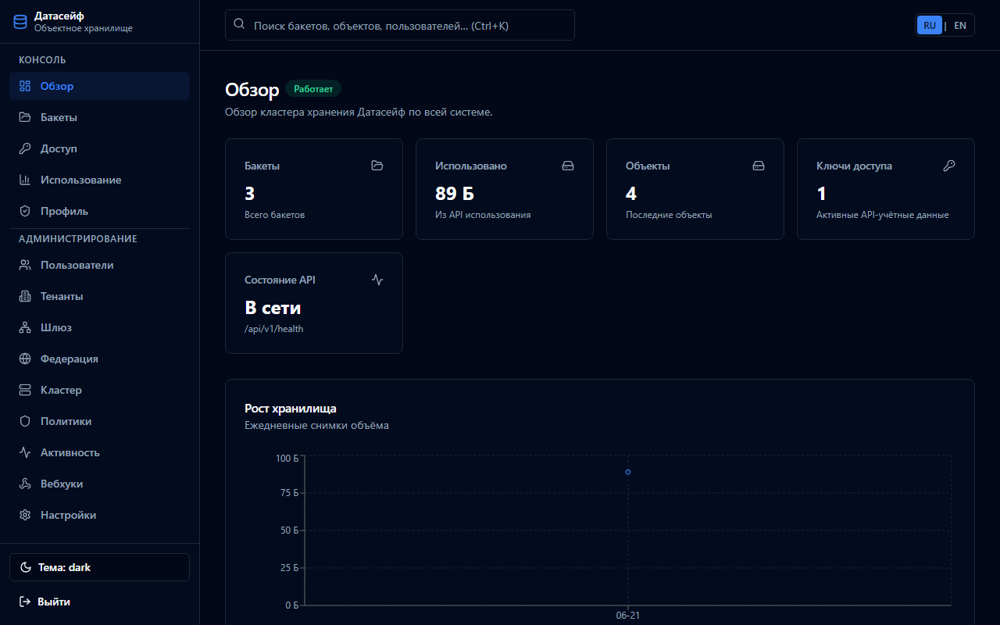
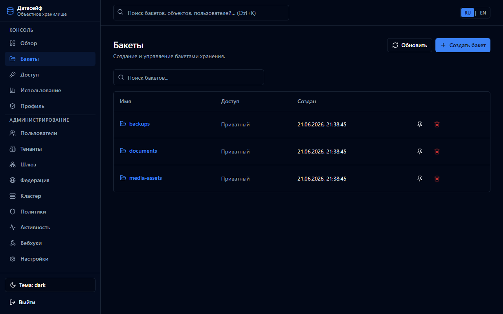
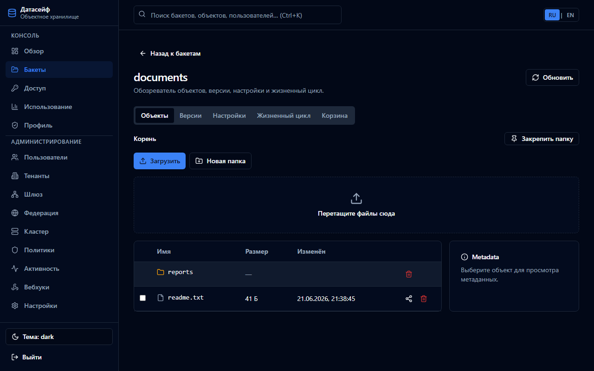
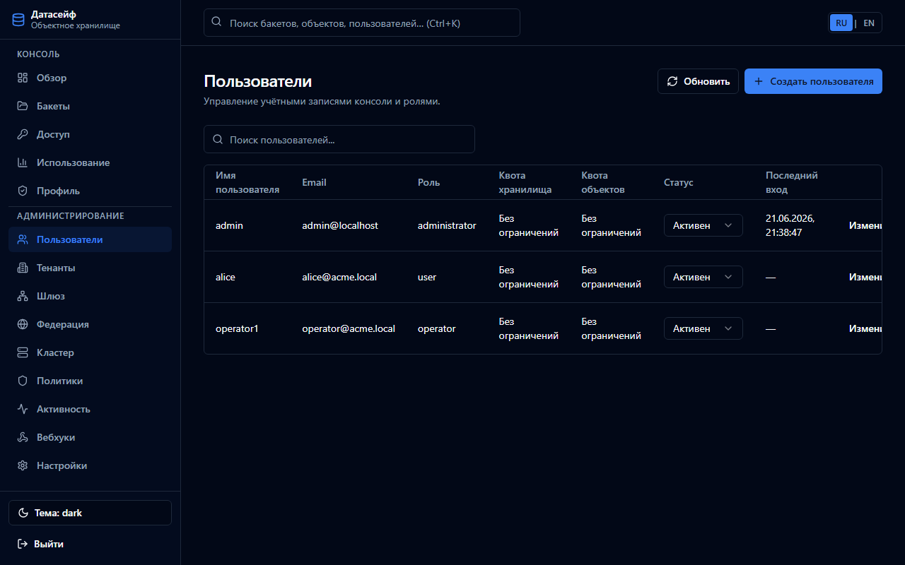
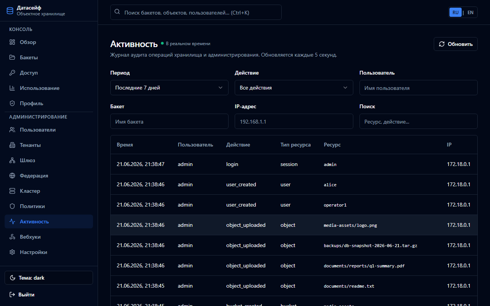
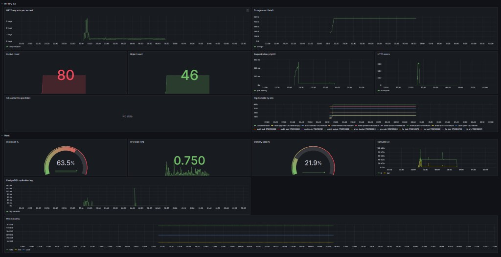

# DataSafeS3 · Датасейф S3

**English:** [README.md](README.md) · **Документация:** [docs/README.md](docs/README.md) · **Релиз:** [v1.7.0](CHANGELOG.md#170---2026-10-19)

Основной репозиторий и реестры артефактов (образы, пакеты, Helm) — на [GitVerse](https://gitverse.ru/DirektorBani/DataSafeS3). GitHub — [зеркало](https://github.com/DirektorBani/DataSafeS3).

Локальное S3-совместимое объектное хранилище. Один процесс или контейнер, метаданные Bolt, отдельная СУБД не нужна. Лицензия [Apache-2.0](LICENSE). Интерфейс консоли доступен на русском и английском.

Автор в уведомлении репозитория: Илья Трачук. Юридические реквизиты для реестра заполняет правообладатель, поля помечены в [лицензии](docs/ru/license.md).

## Что входит в v1.7.0

- S3 API на порту 9000: запись, чтение, head, список v2, составная загрузка, копирование, предподписанные ссылки, версионирование и DeleteObjects (`aws s3 rm --recursive`, `mc`, rclone, restic)
- Веб-консоль, политика бакета, блокировка объекта, журнал, необязательные SSE-S3 и SSE-KMS
- Один узел на Bolt или несколько узлов с общими метаданными PostgreSQL и копией байтов на соседей
- Prometheus `/metrics` с bearer-токеном. Публичный прокси консоли `/metrics` не отдаёт
- Образы релиза `linux/amd64` и `linux/arm64` в реестре GitVerse (SBOM, provenance и cosign — у копии на зеркале GitHub)
- Пакеты `.deb` и `.rpm`, чарт `datasafes3` и production Compose; образы, пакеты и чарт лежат в реестрах [GitVerse](https://gitverse.ru/DirektorBani/DataSafeS3/packages)

Kafka и Vault необязательны. Пустые переменные не открывают соединение.

## Документы для реестра российского ПО

| Документ | Файл |
|----------|------|
| Руководство пользователя | [docs/ru/user-guide.md](docs/ru/user-guide.md) |
| Инструкция по установке | [docs/ru/installation.md](docs/ru/installation.md) |
| Жизненный цикл | [docs/ru/lifecycle.md](docs/ru/lifecycle.md) |
| Функциональные характеристики | [docs/ru/functional-description.md](docs/ru/functional-description.md) |
| Лицензия | [docs/ru/license.md](docs/ru/license.md) |
| Конфиденциальность | [docs/ru/privacy-policy.md](docs/ru/privacy-policy.md) |
| Безопасность | [docs/ru/security-policy.md](docs/ru/security-policy.md) |
| Поддержка | [docs/ru/support.md](docs/ru/support.md) |

Указатель всей документации: [docs/README.md](docs/README.md).

## Быстрый старт

Только S3 API:

```bash
docker run --rm -p 9000:9000 \
  -e STORAGE_ACCESS_KEY=datasafe \
  -e STORAGE_SECRET_KEY=change-me \
  -e STORAGE_ADMIN_PASSWORD=change-me-admin \
  -e STORAGE_JWT_SECRET=change-me-jwt \
  gitverse.ru/direktorbani/datasafe-storage-server:v1.7.0
```

Консоль и API, том, `STORAGE_DEV` выключен:

```bash
cp deploy/compose/production/.env.example deploy/compose/production/.env
docker compose --env-file deploy/compose/production/.env \
  -f deploy/compose/production/docker-compose.yml up -d
```

Kubernetes (пустые секреты чарт не примет):

```bash
helm repo add datasafes3 https://gitverse.ru/api/packages/DirektorBani/helm
helm repo update
helm install ds datasafes3/datasafes3 --version 1.7.0 \
  --set storageServer.image.repository=gitverse.ru/direktorbani/datasafe-storage-server \
  --set console.image.repository=gitverse.ru/direktorbani/datasafe-console \
  --set auth.accessKey=datasafe \
  --set auth.secretKey=change-me \
  --set auth.adminPassword=change-me-admin \
  --set auth.jwtSecret=change-me-jwt \
  --set auth.metricsToken=change-me-metrics
```

Пакеты (служба сама не стартует):

```bash
# Debian, Ubuntu
sudo mkdir -p /etc/apt/keyrings
sudo curl -fsSL https://gitverse.ru/api/packages/DirektorBani/debian/repository.key \
  -o /etc/apt/keyrings/gitverse-DirektorBani.asc
echo "deb [signed-by=/etc/apt/keyrings/gitverse-DirektorBani.asc] https://gitverse.ru/api/packages/DirektorBani/debian stable main" \
  | sudo tee /etc/apt/sources.list.d/gitverse-DirektorBani.list
sudo apt update && sudo apt install datasafes3

# Fedora, RHEL, Rocky, Alma (RPM не подписан GPG, поэтому --nogpgcheck)
sudo dnf install -y dnf-plugins-core
sudo dnf config-manager --add-repo https://gitverse.ru/api/packages/DirektorBani/rpm/stable.repo
sudo dnf install datasafes3 --nogpgcheck

sudoedit /etc/datasafes3/datasafes3.env
sudo systemctl enable --now datasafes3
```

Windows: отдельного MSI в репозитории нет. Из корня клона запустите `install.ps1` или `install.cmd`. Нужен Docker.

Образы можно скачать заранее (реестр публичный, тег `latest` указывает на тот же релиз):

```bash
docker pull gitverse.ru/direktorbani/datasafe-storage-server:v1.7.0
docker pull gitverse.ru/direktorbani/datasafe-console:v1.7.0
```

Подробнее про реестры GitVerse: [docs/ru/gitverse-mirror.md](docs/ru/gitverse-mirror.md). Те же образы есть на зеркале GitHub в `ghcr.io/direktorbani/...`.

## Первый вход

1. Откройте **http://localhost:8080** и войдите `admin` / `admin`, если пароль ещё не меняли.
2. Смените пароль администратора.
3. Завершите мастер настройки. Внешний S3 можно пропустить.
4. Создайте бакет.

| Служба | Адрес | Учётные данные по умолчанию на локальном стенде |
|--------|--------|--------------------------------------------------|
| Консоль | http://localhost:8080 | `admin` / `admin` |
| S3 API | http://localhost:9000 | `datasafe` / `datasafesecret` |
| Grafana | http://localhost:3000 | `admin` / `admin`, только если включён профиль мониторинга |

На боевом контуре эти пароли меняют до того, как узел станет основной копией. Чеклист: [docs/ru/production-checklist.md](docs/ru/production-checklist.md).

## Снимки консоли

| Обзор | Бакеты | Объекты |
|-------|--------|---------|
|  |  |  |

| Пользователи | Журнал | Мониторинг |
|--------------|--------|------------|
|  |  |  |

## Состав репозитория

| Путь | Назначение |
|------|------------|
| `cmd/storage-server` | HTTP-сервер (S3 и Admin API) |
| `web/console` | Веб-консоль |
| `deploy/helm/datasafes3` | Текущий чарт: один узел или HA на PostgreSQL |
| `deploy/helm/datasafe` | Прежний чарт (консоль, Prometheus, Grafana, PostgreSQL) |
| `deploy/compose/` | Оверлеи Compose, включая `production/` |
| `docs/ru/` | Русская документация |

Лицензия Apache-2.0. Пояснение: [docs/ru/license.md](docs/ru/license.md).
