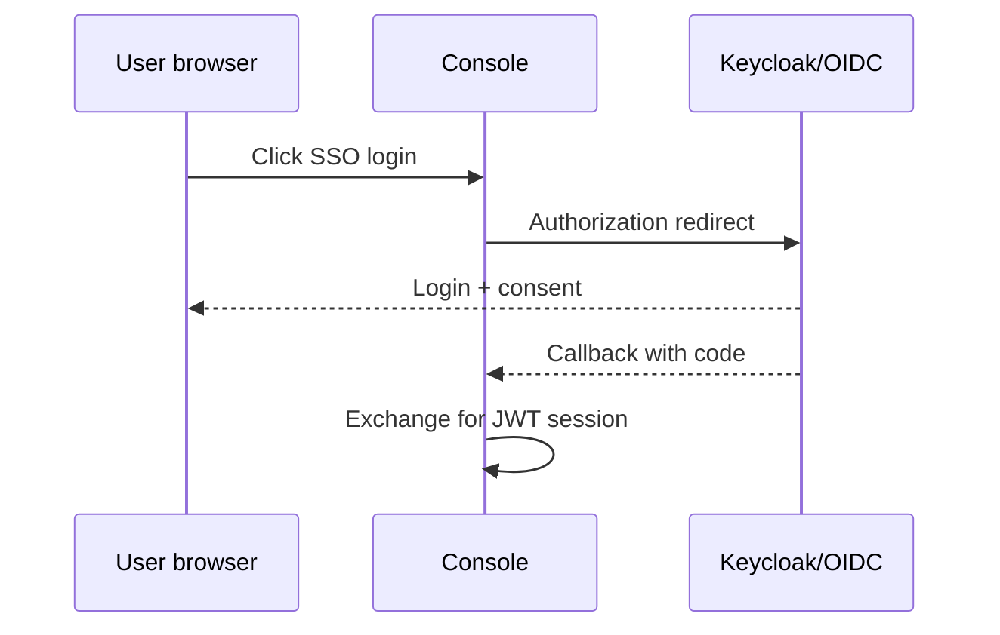

English | **[Русский](../ru/oidc.md)**

# OIDC / SSO

Single sign-on via OpenID Connect (Keycloak and compatible IdPs).

## Configuration

**Admin → Settings → System → OIDC**

- Issuer URL, client ID, client secret
- Redirect URI: `http://your-host:8080/login`
- Optional: password grant for legacy apps

## Login flow

## MFA from the identity provider

DataSafe treats the user as having 2FA when the ID token `amr` contains one of `mfa`, `otp`, `hwk`, `swk`, `fpt` (RFC 8176; override with `oidc_accepted_amr` on the MFA policy) or `acr` matches `oidc_accepted_acr`. That satisfies login and bucket-admin work. Confirming a dangerous action still needs a local TOTP code or security key. Without `amr`/`acr`, a local factor is required after the grace period. LDAP accounts use a local factor only. IdP re-authentication (`prompt=login`, `max_age=0`) is not implemented.

## Test realm

Sample Keycloak realm: [docs/integrations/keycloak-test/](../../integrations/keycloak-test/)

## Full guide

[User guide — LDAP and SSO](../../en/user-guide/README.md#7-ldap-and-sso-keycloak)
