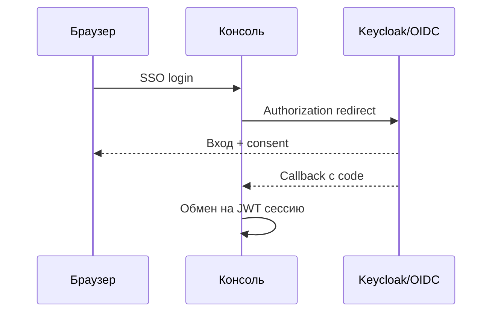

**[English](../en/oidc.md)** | Русский

# OIDC / SSO

Единый вход через OpenID Connect (Keycloak и совместимые IdP).

## Настройка

**Admin → Settings → System → OIDC**

- Issuer URL, client ID, client secret
- Redirect URI: `http://your-host:8080/login`
- Опционально: password grant для legacy-приложений

## Поток входа

## 2FA от поставщика удостоверений

DataSafe считает, что у пользователя есть 2FA, если в ID-токене `amr` есть одно из значений `mfa`, `otp`, `hwk`, `swk`, `fpt` (RFC 8176; список меняется полем `oidc_accepted_amr` политики MFA) или `acr` совпадает с `oidc_accepted_acr`. Этого достаточно для входа и работы администратора бакета. Подтверждение опасного действия по-прежнему требует локальный код TOTP или ключ безопасности. Без `amr`/`acr` после льготного периода нужен локальный фактор. Учётные записи LDAP используют только локальный фактор. Повторная аутентификация у IdP (`prompt=login`, `max_age=0`) не реализована.

## Тестовый realm

Пример Keycloak: [docs/integrations/keycloak-test/](../../integrations/keycloak-test/)

## Полное руководство

[Руководство пользователя — LDAP и SSO](../../ru/user-guide/README.md)
