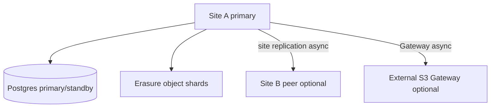

English | **[Русский](../ru/disaster-recovery.md)**

# Disaster recovery

## RPO / RTO targets (HA v2)

| Strategy | RPO (typical lab) | RTO (typical lab) | Complexity |
|----------|-------------------|-------------------|------------|
| Daily tarball backup | 24h | Hours | Low |
| Postgres streaming + erasure intra-site | Seconds (metadata lag) | ≤ 5 min (scripted metadata failover) | Medium |
| Site replication (DataSafeS3 peer) | 30–60s async | Minutes (DNS/ingress to peer site) | Medium |
| Gateway replication (external S3) | Minutes | Hours (restore + re-point) | Medium |
| Legacy shared-FS standby read API | Same as primary disk | N/A (read-only) | Low — **deprecated** |

**Automatic failover** for the full stack is **not** implied unless Patroni (or equivalent) is deployed and documented. CE ships orchestration **scripts**, not an always-on failover controller.

## DR architecture



## Scripted promote

This is a script you run. It is not an automatic multi-AZ failover controller.

```bash
bash scripts/ha/promote.sh --dry-run --primary <old> --standby <replica>
bash scripts/ha/promote.sh --execute --primary <old> --standby <replica>
```

Windows: `scripts\ha\promote.ps1 -DryRun` or `-Execute -PrimaryContainer <old> -StandbyContainer <replica>`. Patroni labs use `scripts/cluster/promote.sh` (same exit codes). A second run is safe: an already-promoted standby and an already-fenced old primary are left alone. Pass the same container names every time. `PRIMARY` is the node that gets fenced, even after it is no longer the writable primary.

### Exit codes

| Code | Meaning |
|------|---------|
| 0 | Promoted, or that state was already true. Dry-run and plan-only also exit 0. |
| 1 | Usage. |
| 2 | Precheck. Lag is above `--max-lag-bytes` (default 1 MiB), the standby is down, or streaming is not visible while the old primary is up. |
| 3 | Fence failed. The old primary still accepted a write. |
| 4 | `pg_promote` or the Patroni switchover failed. |
| 5 | Postcheck failed. The new primary is still in recovery or refused a write. |

### Fence

Before `pg_promote`, the script sets `default_transaction_read_only=on` on the old primary with `ALTER SYSTEM` and reloads. `postgresql.auto.conf` is not replicated, so the promoted standby stays writable. Client backends are terminated. A new session cannot `CREATE TABLE`.

That is not a power fence. A superuser can still `SET transaction_read_only = off` in a session. The storage-server does not. When its leader-lease renew fails against the read-only database, the process drops the lease immediately (`internal/ha`) and `leaderGuard` rejects HTTP writes with `not cluster leader`. It does not wait for the old TTL, and it does not acquire the lease again until the process is started against the new primary.

The event dispatcher does the same as soon as an outbox write is refused. A read-only transaction (`SQLSTATE 25006`) or a not-leader error from the store stops the loop and drops the lease. This process does not publish that row again. A row that was already handed to the sink, and then could not be marked delivered, can be delivered once more by the new leader.

Patroni demotes the old primary instead. That node re-enters recovery and refuses writes. The cluster script does not issue `ALTER SYSTEM`.

After promote, point the new storage node at the new Postgres DSN and restart it. A fresh promote deletes `ha_leader_lock` on the new primary so that node can acquire the lease. A re-run leaves a live lease in place, so it does not drop the new leader. Only the lease holder runs the event dispatcher.

### One-command lab

```bash
bash scripts/ha/run-promote-drill.sh
```

CI job `ha-promote-drill` runs that command on the image produced by `deploy/docker/Dockerfile` (the `docker-build` artifact). It starts Postgres primary and replica, node-a, then node-b only after node-a holds the lease, and a webhook sink. It writes objects while promote runs, then writes `scripts/collect-dr-evidence.sh` output (folder, `summary.md`, `evidence.json`, zip). Host ports default to 19100, 19101, 15442, 15443, and 18080 so the lab does not use `:9000` or `:9001` (the vault stand). Override `HA_DRILL_HTTP_A`, `HA_DRILL_HTTP_B`, `HA_DRILL_PG_A`, `HA_DRILL_PG_B`, and `HA_DRILL_WEBHOOK`. The HA stack's published standby ports default to **19011** and **19013** (`HA_STANDBY_HTTP_PORT`, `HA_STANDBY2_HTTP_PORT`).

## Recovery steps

### Metadata loss / primary Postgres down

1. `scripts/ha/promote.sh --execute` (or `scripts\ha\promote.ps1 -Execute`, or `scripts\ha\failover-metadata.ps1 -Execute`). Dry-run first.
2. Point `STORAGE_POSTGRES_DSN` at the new primary and restart that storage-server with its own `STORAGE_NODE_ID`.
3. Confirm `/healthz` `is_leader=true` on the new node, and that the old primary refuses a SQL write and is not leader.

### Object plane (erasure)

1. Restore **all** shard paths listed in `STORAGE_ERASURE_DATA_PATHS`.
2. Start storage-server with `STORAGE_OBJECT_BACKEND=erasure`; run heal worker until `erasure_degraded=false`.

### Site B takeover

1. Promote Site B Postgres if metadata was replicated (separate deployment).
2. Point DNS / Ingress to Site B console and S3 endpoint.
3. Verify sample object GET and `GET /api/v1/site-replication/status` on remaining site.

## Testing

Run quarterly DR drill: restore backup to an isolated environment, run `bash scripts/ha/run-promote-drill.sh` or `scripts\ha\test-ha-cluster.ps1`, and read the evidence `summary.md`.

`scripts/collect-dr-evidence.sh` (and `.ps1`) records promote timing, replication lag before and after (or `n/a` when the old primary is fenced and nothing is replicating), the idempotent re-run (whether it ran, its exit code, and what it skipped), healthz, an object write/read on the new leader, outbox counts, that the dispatcher runs on the new leader, loss (fails the pack), and component versions. One extra delivery of an in-flight key is allowed. A second extra of the same key fails the pack. `evidence.json` has a top-level `verdicts` map, one `PASS` or `FAIL` per check.

### Not covered

- Automatic failover across availability zones. Nothing here elects a leader by itself.
- Object bytes moving with the metadata. Each node's disk is its own. The post-promote read is a new object written on the new leader.
- A power fence or STONITH. A superuser session can turn read-only off.
- Rebuilding the fenced primary as a new standby. The script does not run `pg_basebackup` in reverse.
- The SSH lab gate runs the promote dry-run and a healthz evidence pack. The timed Patroni election remains the existing kill-leader drill. The compose job is the one that promotes with traffic.

See [reference deployment](./reference-deployment-2node.md) and [scaling](./scaling.md).
