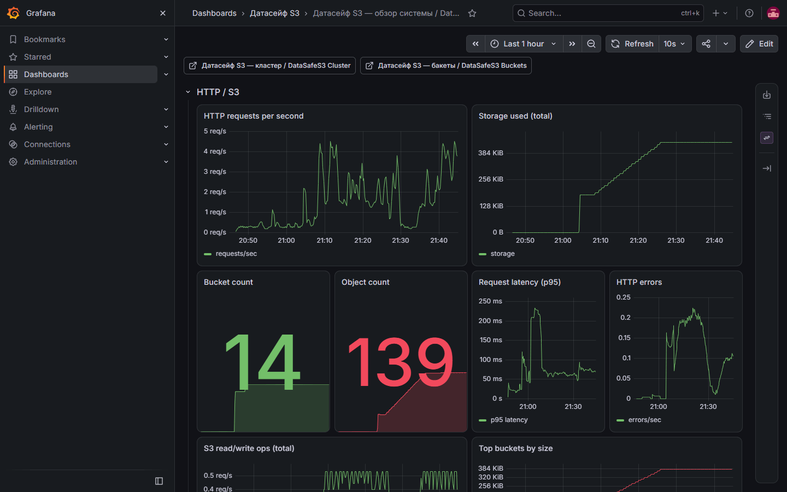

English | **[Русский](../ru/monitoring.md)**

# Monitoring operations

Overview panels: **HTTP / S3** (RPS, counts, storage, latency, errors, top buckets), **Cluster (summary)** (overall status, healthy/offline counts, HA leader), **Host** (disk, CPU, memory, network, Postgres replication lag), **Event delivery** (queue, rates, lag, bridge restarts), and **KMS** (Vault availability by node, request latency, DEK cache, background jobs). The KMS series exist only while Vault Transit is enabled, except `datasafe_kms_jobs_objects_total`, which appears after the first finished object, and the legacy-classification counters, which are registered at process start.

Full per-node table and erasure health: Grafana dashboard **DataSafeS3 Cluster Status** (`deploy/docker/grafana/dashboards/datasafe-cluster.json`, uid `datasafe-cluster`).

## Prometheus

- Scrape target: `storage-server:9000/metrics`
- Config: `deploy/docker/prometheus.yml`
- **Cluster nodes (optional):** edit `deploy/docker/prometheus/targets/cluster-nodes.json` (see `cluster-nodes.example.json`) with each extra node `host:9000`. The shipped file has an empty target list, so single-node is scraped only by the `storage-server` job. Compose mounts that directory into Prometheus for `file_sd`.
- **v1.1.0+:** when `STORAGE_METRICS_TOKEN` is set, `GET /metrics` requires that bearer. **v1.4.1:** the root installer generates the token, and the Compose Prometheus service injects it when the variable is non-empty (`# metrics_auth` in `deploy/docker/prometheus.yml`). See [upgrade § v1.4.1](upgrade.md#upgrading-to-v141).
- **Console note:** the web dashboard reads `/metrics` without a bearer token; when metrics are protected, use Grafana/Prometheus for gauges (console degrades gracefully to zeros).

## Grafana

- URL: http://localhost:3000 (default `admin`/`admin`)
- Dashboards:
  - **DataSafeS3 Overview** — `datasafe-overview`
  - **DataSafeS3 Cluster Status** — `datasafe-cluster` (node UP/DOWN table, overall status, HA role, erasure degraded sets, heal rate, PG lag)
  - **DataSafeS3 Buckets** — `datasafe-buckets`
- **Feature audit (v1.1.0+):** `scripts/feature-audit-test.ps1` runs the same panel query as the overview dashboard (`sum(rate(datasafe_http_requests_total[1m]))`) against Prometheus when Grafana/Prometheus are up in the compose stack.
- Compose pins `grafana/grafana:13.2.3` and `prom/prometheus:v3.15.0`. CI job `event-observability` runs `promtool check rules` on the alert file and provisions that Grafana image, then reads dashboard uid `datasafe-overview` from the HTTP API.

## Event delivery

The overview dashboard row **Event delivery** (`deploy/docker/grafana/dashboards/datasafe-overview.json`, and the Helm copy of that dashboard) uses the dispatcher metrics:

| Panel | Query |
|-------|--------|
| Outbox pending | `datasafe_events_outbox_pending` |
| Delivery rates | `rate` of `datasafe_events_delivered_total`, `datasafe_events_failed_total`, and `datasafe_events_dead_total` by sink, and `datasafe_events_dropped_total` by reason (`pending_cap` is the pending cap, not a sink) |
| Delivery lag | `histogram_quantile` 0.50 / 0.95 / 0.99 of `datasafe_events_delivery_lag_seconds` by sink |
| Sink degraded | `datasafe_events_sink_degraded` is 1 while that destination is degraded, including before the first successful connection |
| Event bridge restarts | `datasafe_events_bridge_restarts_total` counts supervised restarts of the Kafka bridge child |

Example alerts are `deploy/docker/prometheus/alerts.yml`. Compose mounts the file and `deploy/docker/prometheus.yml` loads it with `rule_files`. Edit the pending threshold in that file.

| Alert | Fires when |
|-------|------------|
| `DataSafeEventOutboxPending` | Pending is above 1000, or the pending gauge increased over 10 minutes while rows are still waiting, and that condition holds for 10 minutes |
| `DataSafeEventSinkDegraded` | Any destination has `datasafe_events_sink_degraded` equal to 1 for 5 minutes |
| `DataSafeEventDeadIncreasing` | `datasafe_events_dead_total` increased during the last 10 minutes |
| `DataSafeEventDroppedIncreasing` | `datasafe_events_dropped_total{reason="pending_cap"}` increased during the last 10 minutes |
| `DataSafeKMSUnavailable` | `datasafe_kms_available` stays 0 for 1 minute. The series is published only while Vault Transit is enabled |

## KMS

The overview row **KMS** uses the same dashboard files. An idle node that has not enabled Vault does not publish `datasafe_kms_available`, the request histogram, or the cache counters. Scrape each node so `instance` is that node.

| Panel | Query |
|-------|--------|
| KMS available | `datasafe_kms_available` by `instance`. 1 is the latest Vault probe on that node |
| KMS latency | p50 and p95 of `datasafe_kms_request_duration_seconds` by `instance`, `op`, and `provider` |
| DEK cache | `rate` of `datasafe_kms_dek_cache_hits_total` and `datasafe_kms_dek_cache_misses_total` |
| KMS jobs | `rate` of `datasafe_kms_jobs_objects_total` by `instance`, `job`, and `result` |

Activity records `events_sink_degraded` on the first real failure of a destination and `events_sink_recovered` when it connects again. Retries of the same failure do not add rows. The sentence `waiting for first successful connection` is the status reason before the first probe and is not an Activity row. `events_outbox_dropped` is the pending cap. The console Activity filter lists these actions. `POST /api/v1/events/test` queues a diagnostic event.

## Cluster metrics (Wave 2+)

Published by the storage process that runs the cluster monitor (probes configured nodes’ `/healthz`):

| Metric | Meaning |
|--------|---------|
| `datasafe_cluster_overall_status` | 2=healthy, 1=degraded, 0=offline |
| `datasafe_cluster_nodes_total` | Configured node count |
| `datasafe_cluster_nodes_healthy` | Nodes with healthy `/healthz` |
| `datasafe_cluster_nodes_offline` | Unreachable nodes |
| `datasafe_cluster_node_up{node_id,address,role}` | 1 if that node is up |
| `datasafe_cluster_node_status{…,status}` | Per-node status code |
| `datasafe_ha_enabled` / `datasafe_ha_is_leader` | Storage HA election on this process |
| `datasafe_events_outbox_pending` | Notification rows waiting for delivery |
| `datasafe_events_delivered_total{sink}` | Successful sink deliveries |
| `datasafe_events_failed_total{sink,reason}` | Failed delivery attempts |
| `datasafe_events_dead_total{sink}` | Sinks that exhausted retries |
| `datasafe_events_delivery_lag_seconds{sink}` | Insert to successful delivery |
| `datasafe_events_dropped_total{reason}` | Rows dropped so object writes are not blocked |
| `datasafe_events_sink_degraded{sink}` | 1 while that destination is degraded |
| `datasafe_events_bridge_restarts_total` | Supervised restarts of the Kafka bridge child |

Configure cluster members in Admin API / console **Cluster** settings so the monitor has addresses to probe. Scraping each node’s `/metrics` (file_sd) is optional but useful when comparing host disk/CPU across members.

## Alerts (recommended)

| Alert | Metric |
|-------|--------|
| Disk > 85% | node filesystem / `datasafe_host_disk_used_percent` |
| Gateway replication queue backlog | `datasafe_replication_queue_depth` |
| Site replication lag | `datasafe_site_replication_lag_seconds` |
| Site replication queue | `datasafe_site_replication_queue_depth` |
| Erasure degraded sets | `datasafe_erasure_degraded_shard_sets` |
| Cluster node offline | `datasafe_cluster_nodes_offline > 0` or `datasafe_cluster_node_up == 0` |
| Cluster degraded | `datasafe_cluster_overall_status < 2` |
| HA not leader (unexpected) | `datasafe_ha_is_leader == 0` with writes expected |
| 5xx rate | HTTP metrics |
| Auth failures spike | login counter |

## HA v2 metrics (v1.1.0+)

| Metric | Meaning |
|--------|---------|
| `datasafe_erasure_degraded_shard_sets` | Shard sets missing shards (alert > 0) |
| `datasafe_erasure_heal_bytes_total` | Bytes rebuilt by heal worker |
| `datasafe_site_replication_lag_seconds` | Time since last completed site-replication task |
| `datasafe_site_replication_queue_depth` | Pending site-replication tasks |
| `datasafe_postgres_replication_lag_seconds` | Exposed via `/healthz` / metrics when Postgres backend is used |

Enable site replication worker: `STORAGE_SITE_REPLICATION_ENABLED=true` on the **source** site only.

## External logging

Forward JSON logs to Loki/Elasticsearch for correlation with audit events.

### Outbound URL policy (v1.0.2+)

Admin-configured sink, webhook, and hook-test URLs are validated against SSRF rules (`internal/security/urlpolicy`):

- **Production** (`STORAGE_DEV=false`): only public `https://` targets (private IPs, `localhost`, and metadata IPs blocked).
- **Local dev / CI**: set `STORAGE_DEV=true` (e.g. `deploy/compose/docker-compose.audit.yml`) to allow `http://127.0.0.1` / `host.docker.internal` for Loki. **`STORAGE_OUTBOUND_HTTP_ALLOW` was removed in v1.1.0.**
- Invalid URLs return `400` with `outbound url not allowed: …` when saving settings or testing hooks.

Full guide: [../../en/user-guide/07-monitoring-and-databases.md](../../en/user-guide/07-monitoring-and-databases.md)
