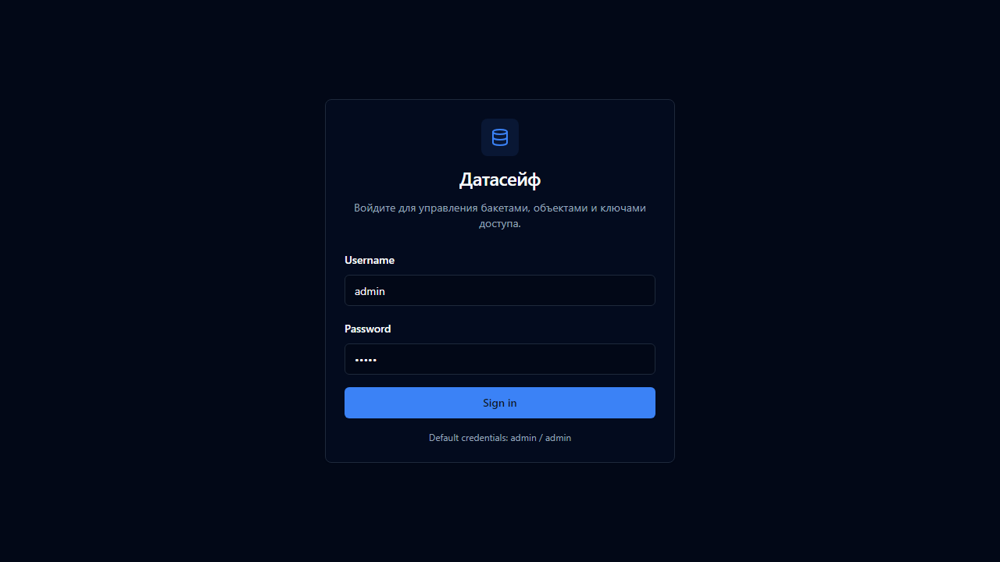
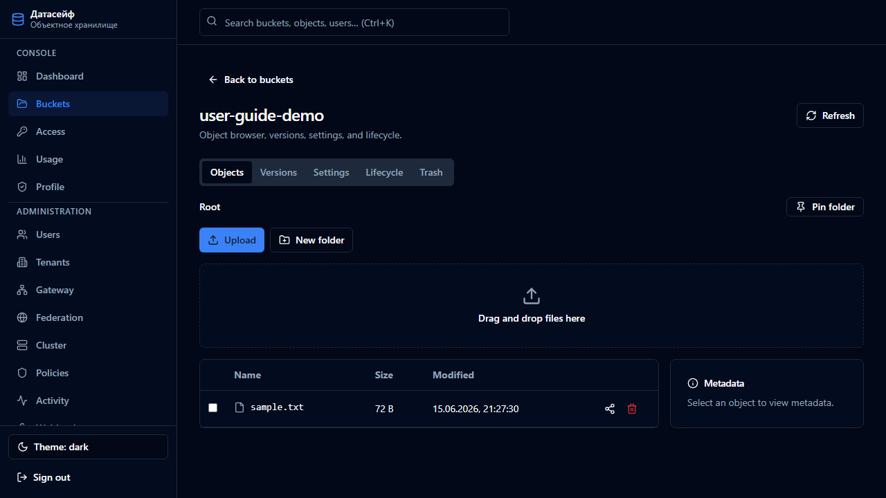
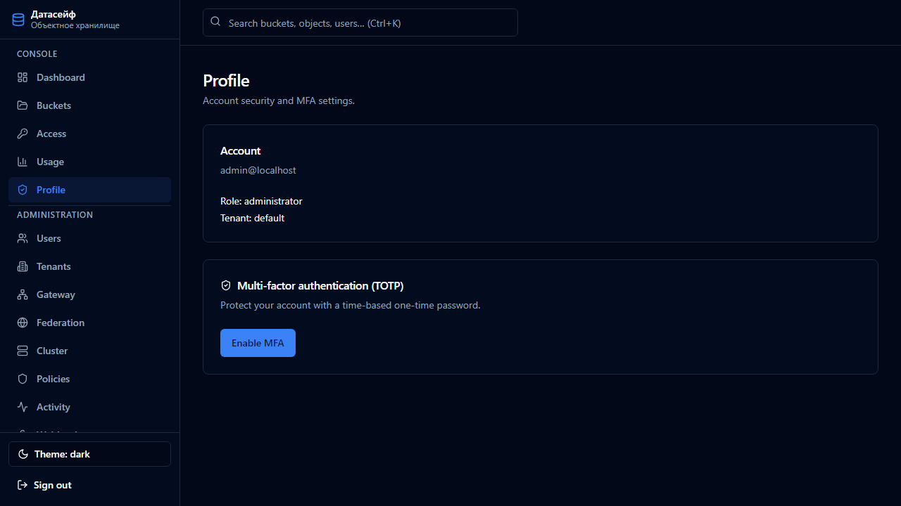

# Руководство пользователя DataSafeS3

**Продукт:** DataSafeS3 (Датасейф S3), релиз **v1.7.0**  
**Интерфейс:** русский и английский  
**Для кого:** пользователь бакета, оператор и администратор веб-консоли

Подробные главы консоли: [user-guide/README.md](user-guide/README.md). Установка сервера: [installation.md](installation.md). Термины: [glossary.md](glossary.md).

Снимки экрана сняты с работающей консоли и лежат в репозитории. Адрес на снимках — локальный стенд `http://localhost:8080`. На вашем сервере хост и порт задаёт администратор (в production Compose консоль публикуется на порту **8080**, S3 API — на порту **9000**).

---

## 1. Что делает консоль

DataSafeS3 хранит объекты в бакетах на вашем сервере и отдаёт их по S3 API. Веб-консоль нужна, чтобы войти, создать бакет, загрузить файл, выдать ключ доступа, посмотреть журнал и, если у вас есть роль администратора, управлять людьми и настройками.

Данные не отправляются поставщику продукта. Куда они уходят, решает администратор вашей установки: на локальный диск, на другие узлы кластера или, если включён шлюз репликации, во внешнее S3.

---

## 2. Вход

1. Откройте адрес консоли. Для Compose по умолчанию это `http://localhost:8080/`.
2. Введите логин и пароль. На свежей локальной установке это `admin` / `admin`.
3. Нажмите **Войти**.
4. Смените пароль администратора. Пока первый запуск не завершён, часть операций закрыта мастером настройки.
5. Пройдите мастер. Внешний S3 необязателен, его можно пропустить.
6. Если включена двухфакторная аутентификация, следующий экран попросит код из приложения-аутентификатора или ключ безопасности.



Корпоративный вход (OIDC) появляется отдельной кнопкой, когда администратор его включил. Учётная запись LDAP входит теми же полями логина и пароля, если каталог подключён.

Роли:

| Роль | Что можно |
|------|-----------|
| user | Свои бакеты и бакеты, к которым выдан доступ: загрузка, скачивание, ключи доступа |
| operator | Операции с бакетами без раздела администрирования |
| administrator | Пользователи, арендаторы, настройки, шлюз, журнал |

---

## 3. Обзор

После входа открывается обзор: занятое место, число бакетов и объектов, переход в остальные разделы.


Боковое меню консоли:

- **Обзор** — сводка
- **Бакеты** — бакеты и объекты
- **Доступ** — ключи доступа
- **Использование** — место, квоты
- **Профиль** — пароль и MFA

Администратор дополнительно видит пользователей, арендаторов, журнал, шлюз и настройки.

---

## 4. Бакеты и объекты

Бакет — контейнер объектов. Имя бакета уникально в этой установке.

1. Откройте **Бакеты**.
2. Создайте бакет и задайте имя.
3. Откройте бакет и загрузите файл. Ключ объекта — это его имя, при необходимости с префиксом (`отчёты/2026/акт.pdf`).
4. Скачивание, удаление и ссылка на объект доступны из браузера объектов.




Версионирование, если его включили, хранит прежние версии ключа. Удаление текущей версии без указания версии пишет маркер удаления, а не стирает историю. Блокировка объекта (Object Lock) в режиме GOVERNANCE или COMPLIANCE и юридическое удержание запрещают удаление до срока или до снятия удержания. Обойти GOVERNANCE может только вызывающий с правом `s3:BypassGovernanceRetention`. COMPLIANCE и юридическое удержание так не обходятся.

Жизненный цикл объектов на этой версии принимает истечение по префиксу в днях. Правила перехода в другой класс хранения, истечения нетекущих версий и фильтр по меткам отклоняются.

Публичное чтение бакета включается отдельно. При включённой блокировке публичного доступа анонимное чтение закрыто.

---

## 5. Ключи доступа и квоты

Ключ доступа нужен программам (`aws`, `mc`, rclone, restic и другим), которые ходят в S3 API на порту **9000**, а не в браузер.

1. Откройте **Доступ**.
2. Создайте ключ. Секрет показывается при создании: сохраните его сразу, консоль не покажет его снова.
3. В клиенте укажите endpoint `http://<хост>:9000`, регион из настройки установки (по умолчанию `us-east-1`) и path-style адресацию. Виртуальные хосты вида `бакет.хост` не обслуживаются.

Корневой ключ установки (`STORAGE_ACCESS_KEY`) не подписывает предподписанные ссылки. Для ссылки нужен ключ пользователя.

Раздел **Использование** показывает, сколько места занято. Администратор задаёт квоты арендатору и бакету. При превышении запись отклоняется.

---

## 6. Профиль и MFA

В **Профиле** меняют пароль и подключают второй фактор: код TOTP или ключ безопасности (WebAuthn).



Если политика MFA требует фактор у администратора, а его ещё нет, консоль не пустит дальше мастера настройки фактора.

Предподписанная ссылка и ссылка общего доступа на зашифрованный объект проверяются ещё раз в момент скачивания: автор ссылки должен существовать, быть активным и иметь право чтения.

---

## 7. Пользователи и арендаторы

Раздел виден администратору.

Пользователь получает роль и, при необходимости, доступ к конкретным бакетам. Арендатор отделяет пользователей и бакеты одной организации от другой.


LDAP и OIDC настраиваются в параметрах системы, а не в карточке каждого человека. Группы сопоставляются с ролями. Подробности: [LDAP](../administrator-guide/ru/ldap.md), [OIDC](../administrator-guide/ru/oidc.md).

---

## 8. Журнал действий

**Журнал** (Activity) пишет, кто создал бакет, загрузил объект, скачал по ссылке, изменил настройку. Записи можно выгрузить. Срок хранения по умолчанию — 90 дней (`STORAGE_ACTIVITY_RETENTION_DAYS`). Ноль отключает очистку.


Секреты Vault, пароли и секреты ключей в журнал и в ответы API не попадают.

---

## 9. Настройки

**Настройки** собирают параметры, которые администратор может менять без правки файла окружения: идентичность, MFA, шифрование бакета, доставку событий, миграцию.


Имеет смысл знать три переключателя:

- **Шифрование бакета.** SSE-S3 (`AES256`) использует ключ сервера и не обращается к Vault. SSE-KMS (`aws:kms`) вызывает Vault Transit только если заданы `STORAGE_KMS_PROVIDER=vault-transit` и адрес. Пока адрес пуст, процесс Vault не открывает. Без заголовка и без шифрования по умолчанию объект остаётся открытым текстом.
- **Доставка событий.** Вебхук, NATS и Kafka — внешняя лента. Они не связывают узлы хранилища между собой. Пустой `STORAGE_KAFKA_BROKERS` не открывает соединение.
- **Миграция.** Страница печатает команды `storage-cli migrate from-minio` и не сохраняет учётные данные источника.

Страница **Settings → Event delivery** показывает очередь исходящих событий. Доставка — at least once: событие могут прислать повторно, если узел потерял лидерство во время отправки.

---

## 10. Шлюз репликации

Шлюз копирует объекты во внешнее S3-совместимое хранилище по правилу. Это не кластер DataSafeS3 и не связь узлов между собой.


Подключение проверяют кнопкой теста. Расписание правила пустое следует глобальному интервалу (`STORAGE_GATEWAY_FULL_SYNC_INTERVAL`, по умолчанию 1 час). Значение `off` останавливает полный обход этого правила, но события объектов продолжают копироваться. Длительность от `1m` до `168h` запускает обход только этого правила.

---

## 11. Мониторинг

`GET /healthz` отвечает, жив ли процесс, и отдаёт версию. `GET /metrics` — метрики Prometheus. Если задан `STORAGE_METRICS_TOKEN`, запрос без этого bearer-токена не проходит. Публичный прокси production Compose (`Caddy`) путь `/metrics` наружу не отдаёт: снимать метрики нужно с порта API во внутренней сети.

В профиле мониторинга установщика рядом поднимаются Prometheus (порт **9090**) и Grafana (порт **3000**, локально `admin` / `admin`). Дашборд **DataSafeS3 Overview** показывает запросы, задержки, объём и доставку событий. Ряд KMS появляется, когда Vault включён.


---

## 12. S3-клиент

Минимальная проверка с хоста, где открыт порт 9000:

```bash
aws --endpoint-url http://127.0.0.1:9000 s3 ls
aws --endpoint-url http://127.0.0.1:9000 s3 mb s3://photos
aws --endpoint-url http://127.0.0.1:9000 s3 cp ./file.txt s3://photos/file.txt
```

У `aws` нужна path-style адресация (`addressing_style = path`). Удаление префикса (`aws s3 rm --recursive`, `mc rm --recursive`) использует DeleteObjects и работает с версии 1.7.0.

Матрица операций: [compatibility.md](compatibility.md).

---

## 13. Чего консоль не делает

- Не ставит сервер и не открывает порты. Это [инструкция по установке](installation.md).
- Не заменяет резервную копию каталога данных. Копия одной только базы без файлов объектов бакет не восстановит.
- Не обещает автоматическое переключение между зонами доступности. Несколько узлов делят метаданные PostgreSQL и копируют байты соседям. Переключение лидера — скриптом, по истечении аренды.
- Не подключает Kafka и Vault сами по себе.

Неисправности: [устранение неполадок](../operations-guide/ru/troubleshooting.md). Поддержка: [support.md](support.md).
