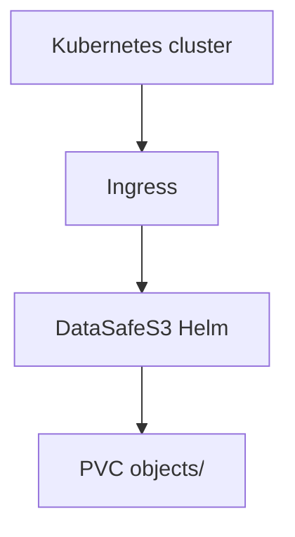

English | **[Русский](../ru/k8s-object-storage.md)**

# Kubernetes object storage

## Problem

Clusters need adjacent S3 storage for Loki, Tempo, Velero, and application uploads under platform team control.

## Solution

Deploy DataSafeS3 with the official Helm chart inside or beside the cluster:

1. `helm install ds deploy/helm/datasafes3` with real `auth.*` values. The earlier chart `deploy/helm/datasafe` is still in the tree.
2. Ingress for the S3 endpoint and the console, or `kubectl port-forward`
3. Per-tenant buckets and credentials for workloads
4. Optional Prometheus ServiceMonitor (`monitoring.serviceMonitor.enabled` on the current chart)

See [Kubernetes](../../kubernetes.md) and the [current chart](../../../deploy/helm/datasafes3/README.md).

## Result

S3 endpoint for cloud-native workloads on infrastructure you operate, with the same governance model as bare-metal deployments.
