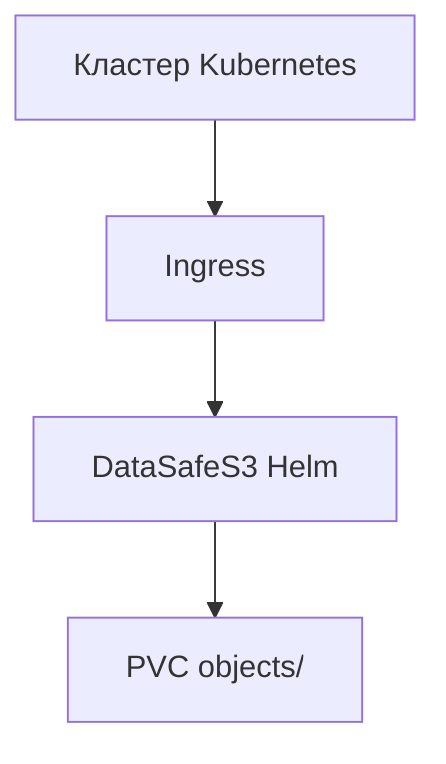

**[English](../en/k8s-object-storage.md)** | Русский

# Объектное хранилище для Kubernetes

## Проблема

Кластерам нужен S3 рядом с workloads для Loki, Tempo, Velero и загрузок приложений под контролем platform-команды.

## Решение

Развёртывание DataSafeS3 через Helm в кластере или рядом:

1. `helm install ds deploy/helm/datasafes3` с настоящими значениями `auth.*`. Прежний чарт `deploy/helm/datasafe` в дереве остаётся.
2. Ingress для S3 и консоли или `kubectl port-forward`
3. Бакеты и учётные данные по арендатору и workload
4. Необязательный ServiceMonitor Prometheus (`monitoring.serviceMonitor.enabled` у текущего чарта)

См. [Kubernetes](../../ru/kubernetes.md) и [текущий чарт](../../../deploy/helm/datasafes3/README.md).

## Результат

S3 для cloud-native workloads на вашей инфраструктуре с той же моделью governance, что и на bare-metal.
